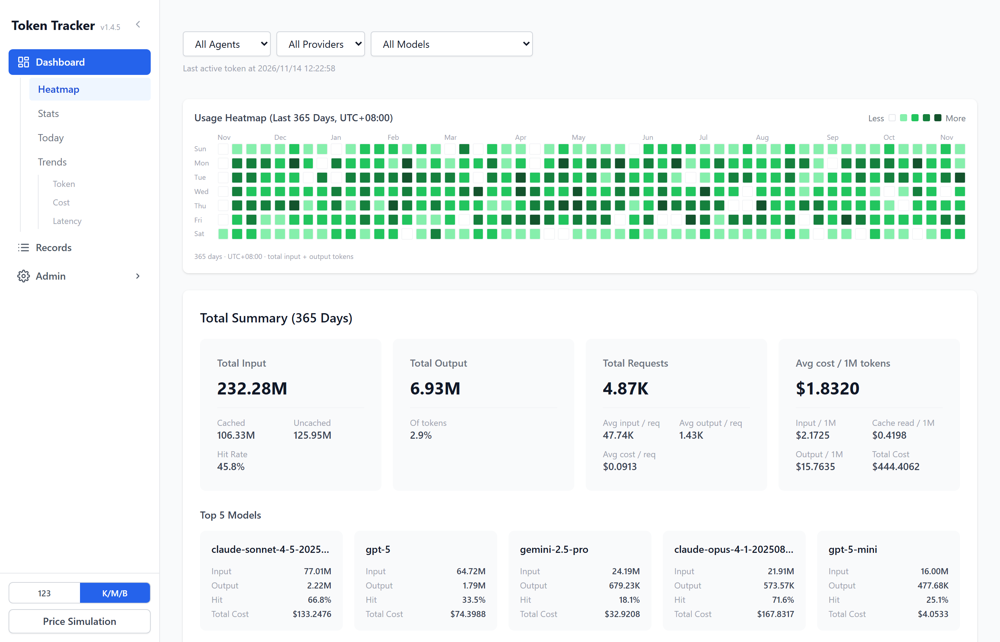

# Token Tracker — Personal AI Gateway

[中文](./README.md) · [Architecture](./docs/architecture.md) · [Screenshots](./docs/screenshots.md) · [Dev / API / Env](./docs/development.md) · [Security & Deployment](./docs/security.md) · [CI (main)](https://github.com/caibingcheng/token-tracker/actions/workflows/ci.yml) · [Docker Image](https://ghcr.io/caibingcheng/token-tracker)

A lightweight personal AI Gateway: unify access to multiple upstream LLM APIs (OpenAI-compatible / Anthropic / Gemini) behind a single set of standard protocol endpoints, proxy requests and responses transparently, and automatically parse and record token usage along the way. Ships with a Token Usage Dashboard and an admin UI.

**Auto-accounting personal AI gateway**: transparent pass-through for OpenAI / Anthropic / Gemini, streaming and non-streaming token usage parsed automatically and attributed per virtual key — zero plugins, clients only change `base_url` and key



More screenshots: [usage trends, records, mobile](./docs/screenshots.md)

## Why this project · Who it's for

When you run AI agents on multiple devices, it's useful to have a real usage ledger — how many tokens of each kind, how much cache hit, which model is fast, what it all costs. Plugin-based recording can't see the full traffic, and enterprise gateways are overkill. So all traffic flows through this gateway entry point, where accounting happens transparently during pass-through — clients never notice.

**Good for**: individual users, heavy multi-device + multi-agent usage, wanting bill-level statistics (cache / latency / cost), and preferring **paid APIs** (stable, with someone to complain to).

**Not for**: team multi-tenant management, or aggregating free API quotas — for those, see other mature alternatives.

## Comparison with other options

I've tried a number of existing solutions (LiteLLM, NEW API, OmniRoute — all great), but for me, I wanted something simpler that includes token stats. So I built a minimal one around my actual needs:

- **Token stats** — auto-parsed for all three protocols streaming and non-streaming, cache read/write tracked separately, attributed per virtual key
- **Latency stats** — per-record latency + streaming TTFT, aggregated by model/date
- **Price simulation & cost estimation** — models.dev official prices auto-matched, see cost directly on the dashboard, and simulate price differences between models
- **Single container** — Docker + SQLite, zero external dependencies; clients only change `base_url` and key

## Features

**Proxying**

- Multi-protocol catch-all pass-through: OpenAI / Anthropic / Gemini, body forwarded unchanged
- Cross-upstream failover: multiple keys per upstream, auth errors switch upstream/key immediately; no retry once streaming has started
- Self-healing health: upstream- and model-level unavailability markers, periodic probes restore automatically
- Session stickiness: requests of the same session pin to one upstream, migrate gracefully on failure
- HTTP CONNECT proxy: optional egress proxy per upstream (stored AES-256-GCM encrypted)
- Named routes: a requested model name maps to a target pool (upstream + real model, failover by priority); an optional LLM classifier picks the chain head per session

**Accounting & statistics**

- Streaming usage parsed incrementally (O(1) memory, no full body buffered)
- cache read / cache write tracked separately with a unified convention (input excludes cache read)
- Per-record latency + streaming TTFT (time to first token), aggregated by model/date with p50
- Usage dashboard: 365-day heatmap / N-day trends / 24h distribution / top models & providers / cost / latency, grouped by browser timezone
- Quotas: per-virtual-key rpm / tpm / daily / monthly limits, 429 without forwarding when exceeded
- Cost estimation: models.dev official price snapshot auto-matched + auto-filled; historical cost recomputed instantly after pricing

**Multi-instance sync**

- Multi-tier deployment: a local instance (B) pushes its own `token_records` to a public main instance (A) through a persistent cursor queue; A dedupes and stores by `uid` + watermark — **loss is observable, duplicates are impossible**
- `uid` is the stable identity key (instances can be renamed at any time); the ingest token is bound by TOFU on first push; A labels sources as `remote/{instance}/{original provider}` and prices pushed models itself
- B can trigger push / skip / reset manually; A can inspect watermarks, cascade-delete one instance's history, revoke/unbind tokens

**Admin UI & interface**

- Sections for upstreams / virtual keys / named routes / model pricing / sync / audit logs
- Model alias normalization (display-level rollup), provider anonymization groups
- Configurable column visibility for the Records / Audit tables, plus action filtering and pagination for audit logs
- Collapsible desktop sidebar (icon-only); on mobile a bottom tab bar, card views for tables, and full-screen modals — installable as a PWA (no Service Worker, offline not enabled)

**Security**

- TOTP two-factor auth + one-time recovery codes (hashes only)
- All secrets stored AES-256-GCM encrypted; virtual keys accepted via headers only (`?key=` removed so keys never reach query logs)
- SSRF protection (address classification at save time plus a connection-time DNS lookup guard against DNS rebinding), XFF spoofing protection, rate-limited login/setup
- Audit log for every admin action. Deployment notes: [Security & Deployment](./docs/security.md)

## Quick Start (Docker)

```bash
docker pull ghcr.io/caibingcheng/token-tracker:latest
cp docker-compose.example.yml docker-compose.yml
# Both credentials are required and have no defaults (compose aborts when missing):
#   ADMIN_API_KEY  >=16 chars with 2+ character classes (openssl rand -hex 24)
#   GATEWAY_SECRET openssl rand -hex 32
export ADMIN_API_KEY="$(openssl rand -hex 24)"
export GATEWAY_SECRET="$(openssl rand -hex 32)"
docker compose up -d
```

First run, three steps:

1. Open `http://host:3000/admin` and log in with a key from `ADMIN_API_KEY` (if unset, a first-run setup wizard appears)
2. Add an upstream (name, protocol, Base URL), configure its API key, and fetch/select the models to enable
3. Create a virtual key and configure your client as in the table below

## Client Setup

| Client | Configuration |
|---|---|
| OpenAI-compatible (Codex / OpenCode, etc.) | `base_url = http://host:3000/v1`, `api_key = vk-xxx` |
| Claude Code (Anthropic protocol) | `ANTHROPIC_BASE_URL = http://host:3000`, `ANTHROPIC_AUTH_TOKEN = vk-xxx` |
| Gemini-protocol clients | `base_url = http://host:3000`, key via the `x-goog-api-key` header (**`?key=` query auth has been removed**: query strings end up in access logs, reverse-proxy logs, and browser history) |
| Other endpoints (e.g. OpenRouter's `/alpha/*`, whose full upstream path is `/api/alpha/*`) | `base_url = http://host:3000/raw`, `api_key = vk-xxx`; the `/raw` prefix is stripped and the inner path appended to the upstream base URL (`https://openrouter.ai/api`) — write the client path as `/alpha/*`, the same way `/v1` maps to `/api/v1` |

Virtual keys (the `vk-` prefix) are created in `/admin`. Sharing one key across devices does not distinguish between devices — create one key per device if you need that.

## Documentation

The detailed docs are written in Chinese.

| Doc | Contents |
|---|---|
| [docs/architecture.md](./docs/architecture.md) | Architecture diagram, request paths, accounting chain, sync topology |
| [docs/screenshots.md](./docs/screenshots.md) | Screenshots: dashboard, usage trends, records, mobile |
| [docs/development.md](./docs/development.md) | Local dev & tests, API overview, environment variables |
| [docs/security.md](./docs/security.md) | First-run fail-open window, HTTPS, secret hygiene, lockout recovery |
| [docs/agents/](./docs/agents/) | Contributor conventions (schema / API / gateway / sync / metrics / tests) |

## License

MIT
