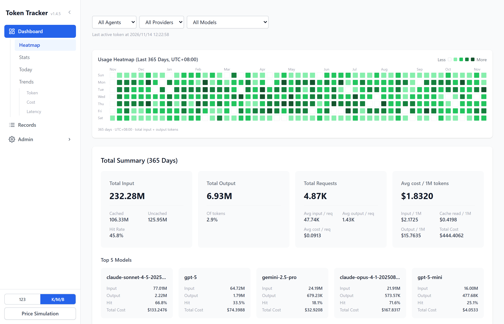

# Token Tracker — 个人 AI Gateway

[English](./README.en.md) · [架构](./docs/architecture.md) · [截图](./docs/screenshots.md) · [开发 / API / 环境变量](./docs/development.md) · [安全与部署](./docs/security.md) · [CI (main)](https://github.com/caibingcheng/token-tracker/actions/workflows/ci.yml) · [Docker 镜像](https://ghcr.io/caibingcheng/token-tracker)

一个轻量级个人 AI Gateway：把多个上游 LLM API（OpenAI 兼容 / Anthropic / Gemini）统一到一个标准协议入口后面，透明转发请求与响应，并在透传过程中自动解析、记录 token 用量。自带用量仪表盘与管理面板。

**自动记账的个人 AI 网关**：OpenAI / Anthropic / Gemini 三协议纯透传，流式/非流式 token 用量自动解析归因——客户端零插件，只改 `base_url` 和 key



更多截图：[用量趋势、Records 明细、移动端](./docs/screenshots.md)

## 为什么做它 · 适合谁

日常在多个设备上用各种 AI agent 时，想要一份真实的用量账本——每类 token 花了多少、缓存命中多少、哪个模型快、成本几何。插件方案记录不到全量流量，商用网关又太重。于是所有流量都改走这个网关入口，记账在透传中完成，客户端毫无感知。

**适合**：个人用户、多设备 + 多 agent 重度使用、想要账单级统计（cache / 延迟 / 成本）、愿意用**付费 API**（稳定、有问题有地方投诉）。

**不适合**：团队多租户管理、免费 API 聚合薅羊毛场景——这部分需求建议用其他的成熟方案。

## 与其他方案的对比

试过不少现成方案（LiteLLM、NEW API、OmniRoute 等都很好用），但是对我来说，我需要更简单的、包含 token 统计的方案。所以我按自己的实际需求做了一台极简的：

- **token 统计**——三协议流式/非流式自动解析，cache read/write 独立记账，按虚拟 key 归因
- **延迟统计**——逐条 latency + 流式 TTFT，按模型/日期聚合
- **价格模拟与费用估算**——models.dev 官方价自动匹配，仪表盘直接看成本，还能模拟不同模型的价格差
- **单容器部署**——Docker + SQLite，零外部依赖；客户端只改 `base_url` 和 key

## 功能

**代理能力**

- 多协议 catch-all 纯透传：OpenAI / Anthropic / Gemini，body 原样转发
- 跨上游故障转移：每个 upstream 可配多个 key，认证错误立即切换上游/key；流式开始后不重试
- 健康自检自愈：upstream / model 级不可用标记，定时探活自动恢复
- 会话粘性：同会话请求锁定同一 upstream，故障时平滑迁移
- HTTP CONNECT 代理：可选为 upstream 配置代理出口（AES-256-GCM 加密存储）
- 命名路由：请求的虚拟模型名 → 目标池（upstream + 真实模型名，按 priority failover）；可选 LLM 分类器每 session 选链首

**记账与统计**

- 流式 usage 增量解析（O(1) 内存，不持有完整响应体）
- cache read / cache write 独立列示，口径统一（input 不含 cache read）
- 逐条记录 latency + 流式 TTFT（首 token 时间），按模型/日期聚合 + p50
- 用量仪表盘：365 天热力图 / N 日趋势 / 24h 分布 / Top 模型与 Provider / 成本 / 延迟，按浏览器时区聚合
- 配额控制：每个虚拟 key 可设 rpm / tpm / 日 / 月上限，超限 429 不转发
- 费用估算：models.dev 官方价快照自动匹配 + 自动填充，补价后历史成本立即重算

**多实例同步**

- 多级部署：本地实例（B）按持久化游标队列把自己的 `token_records` 推给公网主实例（A），A 按 `uid` + 水位去重落库——**丢失可观测，重复不可能**
- `uid` 是稳定身份键（实例可随时改名），ingest token 首次推送 TOFU 绑定；A 侧来源标为 `remote/{实例}/{原 provider}`，推送模型的定价在 A 侧统一
- B 侧可手动推送/跳过/重置，A 侧可看水位、级联清理某实例历史、吊销/解绑 token

**管理面板与界面**

- upstreams / 虚拟 keys / 命名路由 / 模型定价 / 同步 / 审计日志分区
- 模型别名归一化（展示层聚合）、Provider 匿名化分组、Hidden Sources（隐藏/剔除两维度独立）
- Records / Audit 表格列可见性可配，审计日志按 action 筛选 + 分页
- 桌面侧栏可收起为图标栏；移动端为底栏导航 + 表格卡片视图 + 全屏弹窗，可安装为 PWA（无 Service Worker，离线未启用）

**安全**

- TOTP 双因素认证 + 一次性恢复码（只存哈希）
- 所有密钥 AES-256-GCM 加密落库；虚拟 key 只接受 header（`?key=` 已移除，防 query 日志泄露）
- SSRF 防护（保存时地址分类 + 连接时 DNS lookup 校验，防 DNS rebinding）、XFF 伪造防护、登录/设置限流
- 审计日志记录全部管理操作。部署注意事项见 [安全与部署](./docs/security.md)

## 快速开始（Docker）

```bash
docker pull ghcr.io/caibingcheng/token-tracker:latest
cp docker-compose.example.yml docker-compose.yml
# 两个必填变量没有默认值（compose 缺失会直接报错退出）：
#   ADMIN_API_KEY  >=16 字符且至少两类字符（openssl rand -hex 24）
#   GATEWAY_SECRET openssl rand -hex 32
export ADMIN_API_KEY="$(openssl rand -hex 24)"
export GATEWAY_SECRET="$(openssl rand -hex 32)"
docker compose up -d
```

首次启动三步：

1. 打开 `http://host:3000/admin`，用 `ADMIN_API_KEY` 登录（未设置时出现首次设置向导）
2. 添加 upstream（名称、协议、Base URL），配置 key，拉取并勾选启用模型
3. 创建虚拟 key，按下表配置客户端

## 客户端接入

| 客户端 | 配置 |
|---|---|
| OpenAI 兼容（Codex / OpenCode 等） | `base_url = http://host:3000/v1`，`api_key = vk-xxx` |
| Claude Code（Anthropic 协议） | `ANTHROPIC_BASE_URL = http://host:3000`，`ANTHROPIC_AUTH_TOKEN = vk-xxx` |
| Gemini 协议客户端 | `base_url = http://host:3000`，key 走 `x-goog-api-key` header（**`?key=` query 认证已移除**：query 会进访问日志/反代日志/浏览器历史） |
| 其它端点（如 OpenRouter 的 `/alpha/*`，上游完整路径为 `/api/alpha/*`） | `base_url = http://host:3000/raw`，`api_key = vk-xxx`；`/raw` 前缀剥离后拼在 upstream base URL（`https://openrouter.ai/api`）之后——客户端路径按 `/alpha/*` 写，与 `/v1` 之于 `/api/v1` 同理 |

虚拟 key（`vk-` 前缀）在 `/admin` 创建。多个设备共用同一个 key 时无法区分设备——需要按设备各建一个 key。

## 文档

| 文档 | 内容 |
|---|---|
| [docs/architecture.md](./docs/architecture.md) | 架构图、请求路径、记账链路、多实例同步拓扑 |
| [docs/screenshots.md](./docs/screenshots.md) | 截图：Dashboard、用量趋势、Records、移动端 |
| [docs/development.md](./docs/development.md) | 本地开发与测试、API 概览、环境变量 |
| [docs/security.md](./docs/security.md) | 首次设置 fail-open、HTTPS、密钥卫生、忘记 key 恢复 |
| [docs/agents/](./docs/agents/) | 改代码必读的开发约定（schema / API / 代理 / 同步 / 统计口径 / 测试） |

## License

MIT
