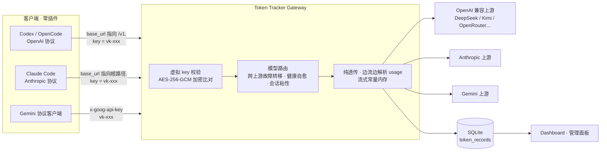
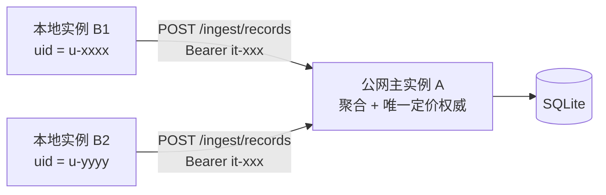

# 架构

> 面向使用者与贡献者的架构概览。代理链路的实现约定见 [`agents/gateway.md`](./agents/gateway.md)，统计口径见 [`agents/data-conventions.md`](./agents/data-conventions.md)。

## 全景

## 请求路径

| 入口 | 处理 | 典型用途 |
|---|---|---|
| `/v1/*` | 校验虚拟 key → 解析模型 → 路由到上游 → 透传 | OpenAI 兼容客户端（base_url 指向 `/v1`） |
| `/v1beta/*` | 同上 | Gemini 协议客户端 |
| `/raw/*` | 先剥离 `/raw`，把内层路径拼到上游 base URL 后走同一套流程 | `/v1`、`/v1beta` 之外的端点（如 OpenRouter 的 `/alpha/*`） |

三个入口都是 catch-all 纯透传：请求体原样转发，响应边流边解析 `usage`，不缓存完整响应体。

## 记账链路

1. 虚拟 key 校验通过后，请求进入路由层：命名路由（含可选 LLM 分类器）→ 自动路由 → upstream key 故障转移链
2. 透传过程中增量解析上游 `usage`（OpenAI / Anthropic / Gemini 三种格式，流式与非流式同口径）
3. 写 `token_records`：`model` 记发往 upstream 的真实名，`request_model` 记客户端原始名；`input_tokens` 不含 cache read，`cache_read` / `cache_write` 独立列
4. Dashboard / Records 读库聚合，展示层再叠加模型别名归一化与 Provider 匿名化

## 多实例同步拓扑

- B 侧按持久化游标队列推送自己的 `token_records`，A 侧按 `uid` + 水位去重落库；`/ingest/records` 独立于会话认证
- A 侧把来源改写为 `remote/{实例}/{原 provider}`、`virtual_key_id = -1`（哨兵，不再向外转发，天然断开环路），定价与归一化仍在 A 侧完成
- 详见 [`agents/sync.md`](./agents/sync.md)
