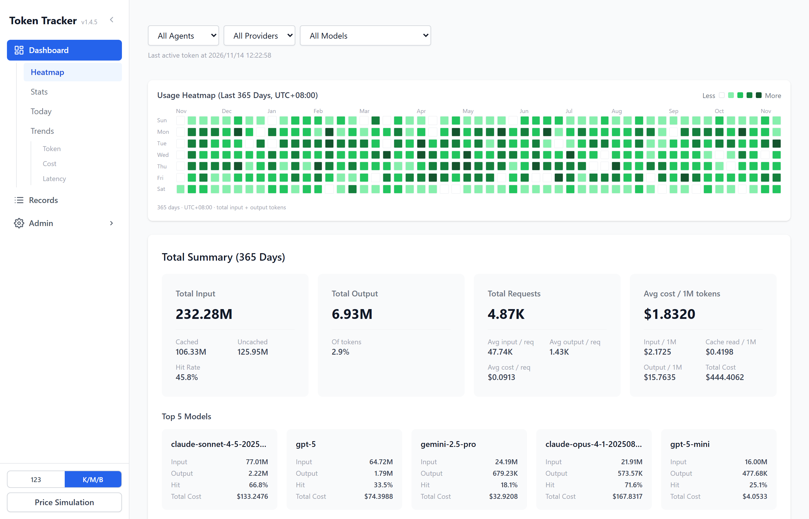
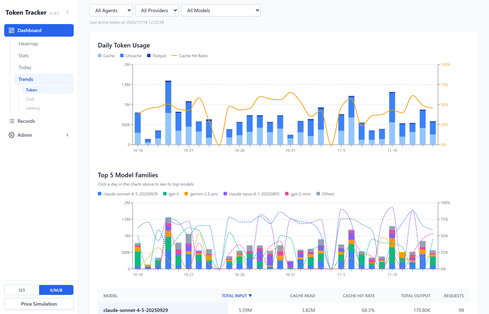
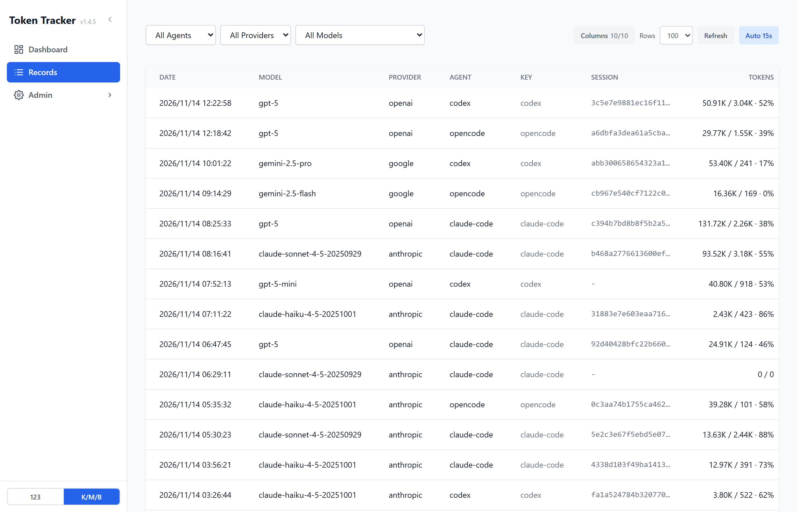
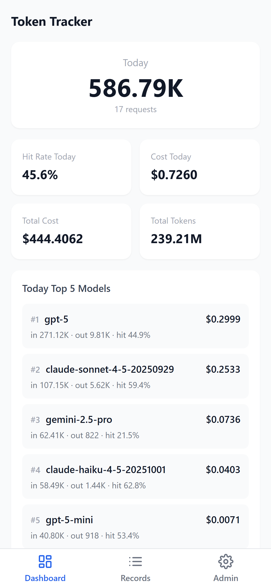
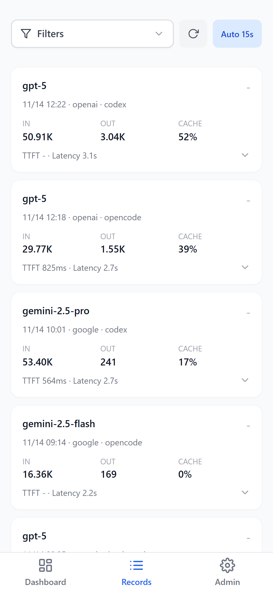

# 截图

> 界面 v1.4.5，数据由 `npm run seed:demo` 生成的 365 天演示记录（非真实账单）。全部截图为 2x / 3x 高清。

## Dashboard 概览

365 天热力图、Total Summary（输入/输出/请求数/平均单价的 1M token 成本，含 cache 命中率与拆分明细）、Top 5 模型。左侧为可收起的侧栏导航，右侧筛选栏可按 Agent / Provider / 模型过滤，数字支持 `123` / `K/M/B` 两种格式。

## 用量趋势

Daily Token Usage（Cache / Uncached / Output 堆叠 + cache 命中率折线）、Top 5 Model Families（按模型族堆叠，点击某天可下钻）、模型明细表（Total Input / Cache Read / Cache Hit Rate / Total Output / Requests，默认按 input 降序）。时间窗可切 3d / 7d / 14d / 30d。

## Records 明细

逐条请求记录：时间、模型（发往 upstream 的真实名）、Provider、Agent（按 User-Agent 派生）、虚拟 key、Session、Tokens（`in / out · xx% cached`）。10 列可自由勾选显示，支持自动刷新与分页。

## 移动端

<table>
<tr>
<td></td>
<td></td>
</tr>
</table>

`<768px` 下切换为移动布局：Dashboard 用大字卡展示 Today / 成本 / 总量，Records 表格改为卡片并支持点开完整明细（含 Manual / Requested 模型名、Prompt 分解、精确延迟），筛选与列选择收进底部抽屉，底栏固定 Dashboard / Records / Admin 三个导航入口。可安装为 PWA。
